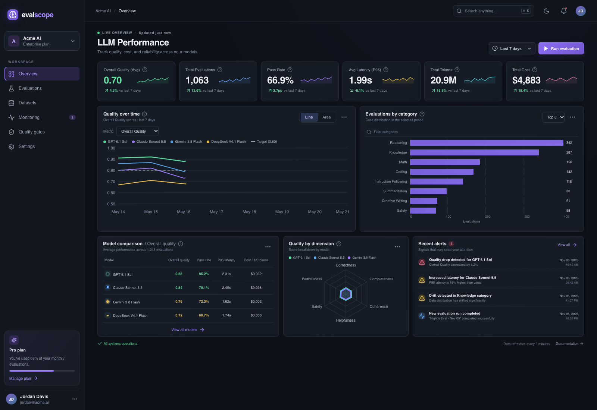
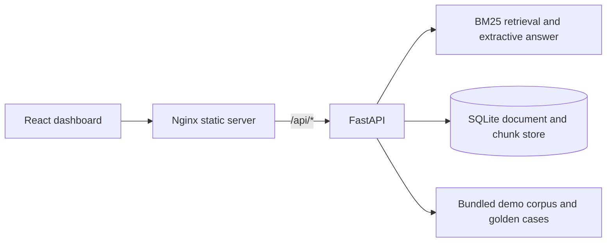

# EvalScope

EvalScope is a portfolio demo for inspecting LLM evaluation and monitoring workflows. It combines a responsive React dashboard with a runnable FastAPI retrieval demo. The API ingests text documents, retrieves supporting passages, returns citation-backed extractive responses, and evaluates retrieval against a small public sample set.

> **Demo data:** Dashboard aggregates are illustrative fixtures. The API corpus and golden cases are fictional examples. No model calls or provider costs are simulated as real measurements.

## Try the demo

Requirements: Docker Desktop with Compose, or Node.js 22+ and Python 3.12+.

```sh
docker compose up --build
```

Then open:

- Dashboard: <http://localhost:4173>
- API reference (Swagger UI): <http://localhost:8000/docs>
- API schema (OpenAPI JSON): <http://localhost:8000/openapi.json>
- API health: <http://localhost:8000/healthz>

If port 8000 is already in use, start Compose with `API_PORT=8001 docker compose up --build -d` and open the API docs at <http://localhost:8001/docs>.

Try a grounded answer in another terminal:

```sh
curl -sS http://localhost:8000/api/v1/chat \
  -H 'Content-Type: application/json' \
  -d '{"query":"What should the assistant do when evidence is missing?"}'
```

Run the bundled retrieval evaluation:

```sh
curl -sS -X POST http://localhost:8000/api/v1/evaluate \
  -H 'Content-Type: application/json' -d '{}'
```

`make demo` starts the same Compose stack in the background and prints the local URLs. Use `make down` to stop it. Compose stores the demo's SQLite database in a named volume.

## Screenshots



The screenshot shows the dashboard UI; its KPI values are sample data. The live API demo is documented above.

## Architecture



The API keeps core retrieval code in pure functions so ranking and chunking can be tested without FastAPI or a database. SQLite persists uploaded documents and their chunks. The dashboard currently presents seeded example aggregates and is not wired to the API metrics.

See [architecture notes](docs/architecture.md), [API reference](docs/api.md), [metrics definitions](docs/metrics.md), and [known limitations](docs/limitations.md).

## Local development

Frontend:

```sh
npm ci
npm run dev
```

Backend (Python 3.12):

```sh
python3 -m venv .venv
source .venv/bin/activate
python -m pip install -r backend/requirements-dev.txt
uvicorn app.main:app --app-dir backend --reload
```

Open the API docs at <http://localhost:8000/docs>. By default, local API data is stored at `data/evalscope.sqlite3`; set `DATABASE_PATH` to use another location.

## Tests

Install the backend development requirements, then run:

```sh
make test
```

`backend/tests/test_retrieval.py` covers chunking, tokenization, and BM25 ranking. `backend/tests/test_api.py` exercises the HTTP contract, document persistence, citations, abstention, evaluation, and validation. The integration tests use a temporary SQLite database and the bundled corpus; they do not call external services.

Build the web app with `npm run build`.

## Example data

- `data/demo_corpus.json` contains fictional guidance about RAG, evaluation, API operations, and privacy.
- `data/golden_cases.json` contains synthetic questions and expected source IDs.

The fixtures contain no confidential or user data. Add demo documents through `POST /api/v1/documents` with `id`, `title`, and `content` fields.

## Current scope and limitations

- Retrieval uses lexical BM25-style scoring, not vector embeddings or semantic search.
- Chat answers quote the highest-ranked passage. There is no LLM generation, judge model, or live provider integration.
- SQLite is for a single-user local demo. There is no authentication, multi-tenancy, rate limiting, production retention, or PII redaction layer.
- Dashboard aggregates and comparison scores are static sample values; they do not come from the API or live evaluations.
- The evaluation endpoint measures retrieval against expected source IDs only. It does not score answer correctness, hallucination, latency, tokens, or cost.
- No deployment, CI workflow, or production security review is included yet.

These boundaries are deliberate so the demo remains reproducible without API keys. Do not expose it publicly or use confidential documents.

## Selected AI engineering project

**EvalScope: RAG Retrieval & Evaluation Demo** — Python, FastAPI, React, SQLite, Docker. Built local document ingestion, BM25 retrieval, citation-backed extractive responses with abstention, retrieval evaluation metrics, OpenAPI docs, synthetic example data, and Docker Compose. This is a reproducible portfolio demo; it does not yet implement vector search or LLM-generated responses.
