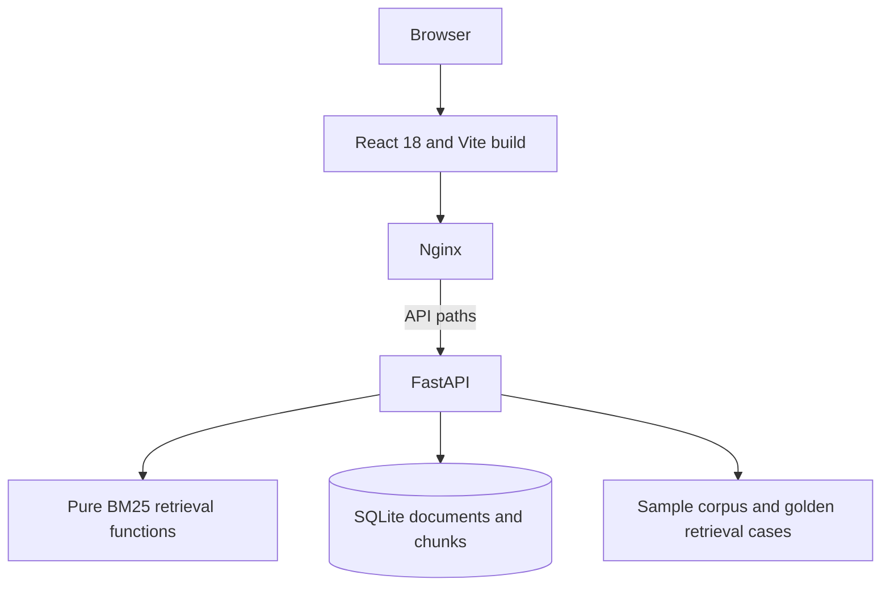

# Architecture

## Runtime

The frontend and API are separate services in Compose. Nginx serves the built dashboard and proxies `/api/*` and `/healthz` to FastAPI. The API is published on host port 8000 by default so its generated Swagger and OpenAPI pages are easy to inspect; set `API_PORT` to choose another host port.

## Data flow

1. On first start, FastAPI creates SQLite tables and inserts the bundled corpus if the database has no documents.
2. `POST /api/v1/documents` splits supplied text into bounded chunks and stores the document and chunks transactionally.
3. Search tokenizes the query and chunks, calculates BM25-style lexical scores, then returns top matching source passages.
4. Chat quotes the best passage verbatim and returns all ranked citations. If nothing matches, it abstains.
5. Evaluate runs the same retriever against reference source IDs and reports Hit Rate, MRR, Precision@k, and Recall@k.

## Configuration

| Variable | Default | Purpose |
| --- | --- | --- |
| `DATABASE_PATH` | `data/evalscope.sqlite3` | SQLite database location |
| `CORPUS_PATH` | `data/demo_corpus.json` | Initial seed corpus |
| `GOLDEN_DATASET_PATH` | `data/golden_cases.json` | Default retrieval evaluation cases |

Compose overrides `DATABASE_PATH` to a named volume mounted at `/var/lib/evalscope`.
